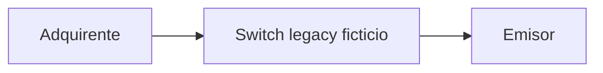

# Current Architecture (As-Is)

> **🟨 ASSUMPTION — dry-run 001.** Generado en automático el 2026-10-24. Las compuertas humanas se omiten a propósito. Esto no es una aprobación.

## 1. System context (C4 L1)

## 2. Containers / components (C4 L2) for in-scope processes
| Component | Tech | Responsibility | Repo | Process IDs |
|---|---|---|---|---|
| switch_core | Python | Timeout, reverso y reintentos | dry-run-legacy | P-REV |

## 3. Key data flows
En línea: el switch espera al emisor y, si vence el timeout, envía el reverso al adquirente.

## 4. Data stores
| Store | Tech | Main entities | Owner |
|---|---|---|---|
| — | memoria | constantes del módulo | dry-run |

## 5. Known pain points / tech debt
El timeout está fijo en código. Los documentos no coinciden con ese número.
