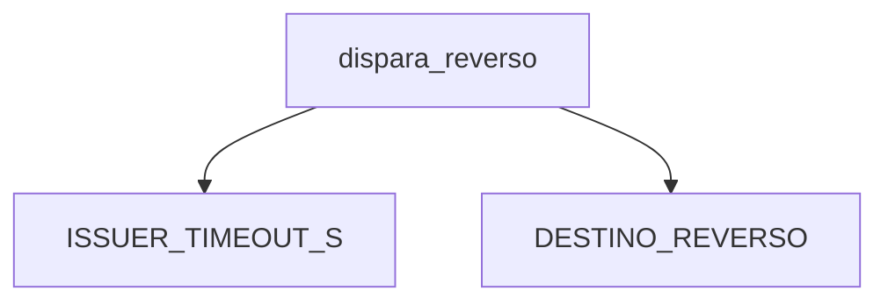

# Code Map (SPIKE-001)

> **🟨 ASSUMPTION — dry-run 001.** Generado en automático el 2026-10-24. Las compuertas humanas se omiten a propósito. Esto no es una aprobación.

- **Repos analyzed:** dry-run-legacy@dry-run-001

## P-REV Reverso por timeout del emisor
### Entry points
| Type (API / batch / consumer / UI) | Identifier (endpoint, job, topic) | Location |
|---|---|---|
| función | dispara_reverso | legacy-readonly/switch_core/reversal.py |

### Call chain

### Key components
| Component | Responsibility | Location | KUs |
|---|---|---|---|
| reversal.py | Reglas del reverso | legacy-readonly/switch_core/reversal.py | KU-CODE-REV-001, KU-CODE-REV-002, KU-CODE-REV-003, KU-CODE-REV-004 |

### Config and constants
| Name | Line | Where defined | Runtime-overridable? |
|---|---|---|---|
| if emisor_id not in EMISORES_AUTORIZADOS: | 10 | reversal.py:10 | no |
| DESTINO_REVERSO = "adquirente" | 28 | reversal.py:28 | no |
| ISSUER_TIMEOUT_S = 25 | 40 | reversal.py:40 | no |
| MAX_REINTENTOS = 3 | 52 | reversal.py:52 | no |

### Observations
`ISSUER_TIMEOUT_S` y `MAX_REINTENTOS` están fijos. No hay prueba en el módulo legacy.
