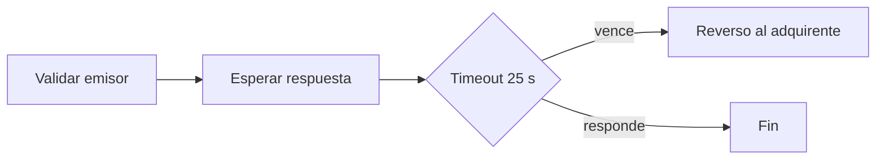

# Validated As-Is: P-REV Reverso por timeout del emisor

> **🟨 ASSUMPTION — dry-run 001.** Generado en automático el 2026-10-24. Las compuertas humanas se omiten a propósito. Esto no es una aprobación.

- **Spike:** SPIKE-001 · **Version:** 1.0 · **Date:** 2026-10-24
- **Coverage:** As-Is KUs found in code: 75% · Code KUs documented: 75%

## 1. Overview
Proceso ficticio. El switch rechaza emisores fuera de lista, espera la respuesta y, si vence el timeout, envía un reverso al adquirente. El timeout validado es el del código: 25 segundos.

## 2. Actors and systems
Adquirente, switch, emisor.

## 3. Process flow

## 4. Business rules (validated)
| Rule ID | Step | Rule | Basis (✅ match / decision) | Citations |
|---|---|---|---|---|
| VR-REV-001 | 1. Validar al emisor | Cuando el emisor no está en la lista de emisores autorizados, el sistema rechaza la transacción antes de enviarla. | ✅  KU-ASIS-REV-001 = KU-CODE-REV-001 | doc:ASIS-REV-proceso-reverso.md#1.1 · code:legacy-readonly/switch_core/reversal.py:10@dry-run-001 |
| VR-REV-002 | 2. Enviar el reverso | Cuando se dispara un reverso, el sistema lo envía al adquirente. | ✅  KU-LEG-REV-001 = KU-ASIS-REV-002 = KU-CODE-REV-002 | doc:LEG-REV-proceso-reverso.md#2.1 · doc:ASIS-REV-proceso-reverso.md#2.1 · code:legacy-readonly/switch_core/reversal.py:28@dry-run-001 |
| VR-REV-003 | 3. Esperar respuesta del emisor | Cuando el emisor no responde en 25 segundos, el sistema genera un reverso automático hacia el adquirente. | decisión D-003 KU-LEG-REV-002 = KU-ASIS-REV-003 = KU-CODE-REV-003 | doc:LEG-REV-proceso-reverso.md#3.2 · doc:ASIS-REV-proceso-reverso.md#3.2 · code:legacy-readonly/switch_core/reversal.py:40@dry-run-001 |

## 5. Data entities
Emisor, transacción, reverso. Sin almacén en este dry run.

## 6. Integrations
INT-01 Emisor, saliente, HTTP. En el PoC va simulada.

## 7. Known gaps and open items
| Item | Type (undocumented / orphan / open) | Owner | Ref |
|---|---|---|---|
| cola-manual | orphan | dry-run | DISC-REV-001 |
| reintentos | undocumented | dry-run | DISC-REV-002 |

## 8. Sign-off
| Role | Name | Date |
|---|---|---|
| As-Is owner | omitida en dry-run 001 | |
| Tech Lead | omitida en dry-run 001 | |
