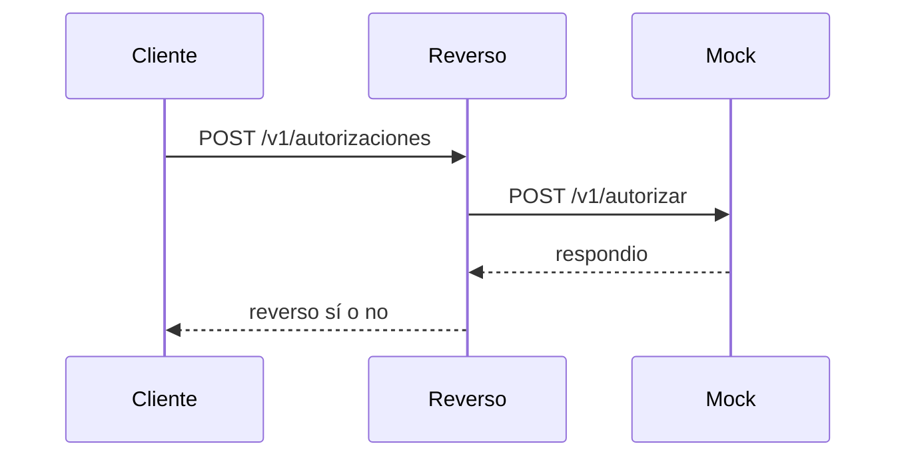

# Design

> **🟨 ASSUMPTION — dry-run 001.** Generado en automático el 2026-10-24. Las compuertas humanas se omiten a propósito. Esto no es una aprobación.

## Context
Diseño provisional. La imagen base aprobada de OpenShift sigue sin dato de eGlobal. Referencias: `00-context/architecture/target-architecture.md` y `adr/ADR-001-poc-approach.md`.

## Goals / Non-Goals
- Cumplir el timeout por emisor, con 25 segundos por defecto.
- Fuera de meta: cola manual y reintentos.

## Decisions
ADR-001: uno o dos contenedores, integraciones simuladas, datos sintéticos.

| Component | Responsibility | Tech |
|---|---|---|
| reverso | Decide si hay reverso | Python 3.12, biblioteca estándar |
| emisor-mock | Responde la consulta del emisor | Python 3.12, biblioteca estándar |

Sin persistencia. La configuración entra por variables de entorno.

- `POST /v1/autorizaciones` cuerpo `emisor_id`, `respondio`, `transcurrido_s`. Respuesta `reverso`, `destino`, `timeout_s`.
- `POST /v1/autorizar` en el mock. Respuesta `respondio`.
- `GET /health` en ambos.

INT-01 se simula con `emisor-mock`. El mock rechaza un token distinto. El log sale a stdout. Un JSON inválido responde 400.

## Risks / Trade-offs
El proceso es ficticio. Un despliegue en el clúster de eGlobal no está hecho.

## Migration Plan
El legacy sigue aparte. Este PoC no lo reemplaza.

## Open Questions
La imagen base aprobada de OpenShift no está.
