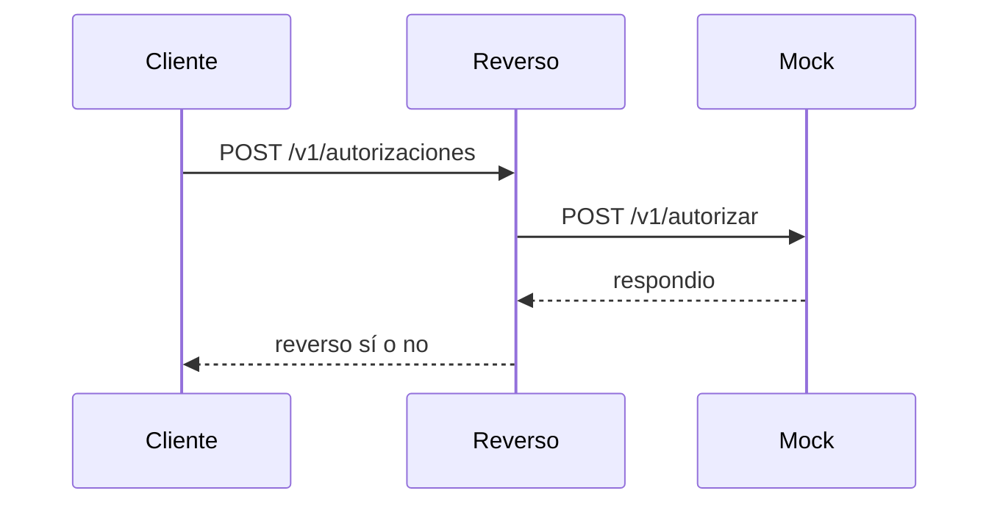

# SDD: CAP-001-reverso-timeout Reverso por timeout del emisor

> **🟨 ASSUMPTION — dry-run 001.** Generado en automático el 2026-10-24. Las compuertas humanas se omiten a propósito. Esto no es una aprobación.

- **Version:** 0.1 · **PRD:** ./prd.md · **Architecture refs:** 00-context/architecture/target-architecture.md, adr/ADR-001-poc-approach.md
- **Design status:** provisional (la imagen base aprobada de OpenShift sigue sin dato de eGlobal)

## Part 1: Requirements
### REQ-001 Timeout de reverso configurable por emisor
- **EARS:** When el emisor no responde dentro de su timeout, the system shall generar un reverso hacia el adquirente.
- **Source:** decisión D-001 / PRD G1
- **Change:** modified
- **Acceptance criteria:**
  - [ ] AC-001.1 Given el emisor A con timeout 20 s, when no responde y ya van 20 s, then se genera un reverso al adquirente.
  - [ ] AC-001.2 Given un emisor sin configuración, when no responde y ya van 25 s, then se genera un reverso al adquirente.
  - [ ] AC-001.3 Given un emisor sin configuración, when no responde y van 24 s, then no se genera reverso.

### Non-functional requirements
| NFR | Target | Ref nfrs.md |
|---|---|---|
| Latencia de la decisión | Sin espera de reloj en la prueba | Latency |
| Token hacia el mock | Bearer con el valor del Secret de ejemplo | Security |

## Part 2: Design
### Components

| Component | Responsibility | Tech (per standards.md) |
|---|---|---|
| reverso | Decide si hay reverso | Python 3.12, biblioteca estándar |
| emisor-mock | Responde la consulta del emisor | Python 3.12, biblioteca estándar |

### Data model
Sin persistencia. La configuración entra por variables de entorno.

### APIs / events / files (contracts)
- `POST /v1/autorizaciones` cuerpo `emisor_id`, `respondio`, `transcurrido_s`. Respuesta `reverso`, `destino`, `timeout_s`.
- `POST /v1/autorizar` en el mock. Respuesta `respondio`.
- `GET /health` en ambos.

### Key sequences

### Integrations (ref integration-catalog.md)
INT-01 simulada por `emisor-mock`.

### Security, observability, error handling
El mock rechaza un token distinto. El log sale a stdout. Un JSON inválido responde 400.

### Design decisions (ADRs)
ADR-001: uno o dos contenedores, integraciones simuladas, datos sintéticos.

## Part 3: Tasks
| Task | Description | REQ refs | Est. | PoC slice? |
|---|---|---|---|---|
| T-01 | Servicio de decisión y HTTP | REQ-001 | S | Y |
| T-02 | Mock del emisor | REQ-001 | S | Y |
| T-03 | Containerfile, ConfigMap, Secret de ejemplo, Deployment | REQ-001 | S | Y |
| T-04 | Pruebas AC-001.1 a AC-001.3 | REQ-001 | S | Y |

## Test strategy
unittest sobre la función de decisión y una llamada HTTP local. Cada prueba lleva el ID del AC en el nombre.
