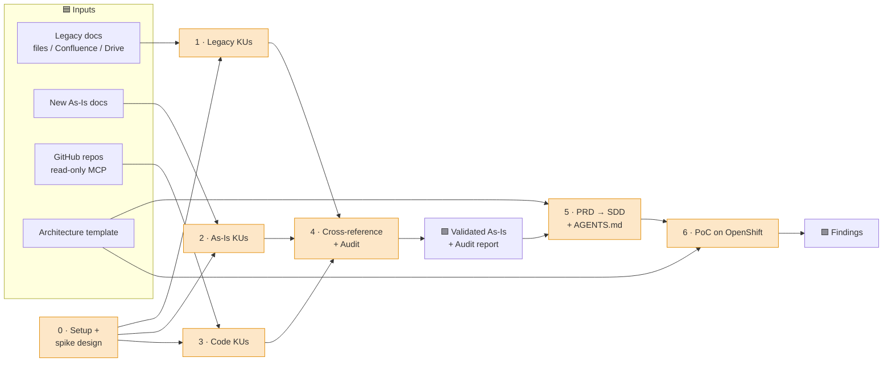

# eGlobal Brain 🧠

**The single source of truth for validating eGlobal's As-Is and prototyping its To-Be, using LLM agents with humans in the loop.**

This repo holds **knowledge and process**, not production code. Agents read three sources (legacy docs, new As-Is docs, code through a read-only GitHub MCP), turn them into one **validated As-Is**, write the **To-Be spec** (PRD → SDD), and build **PoCs** on OpenShift. Humans approve every step.

Works with **any LLM tool**: Gemini Enterprise, Claude Code, Codex, Devin. All instructions live in [`AGENTS.md`](AGENTS.md).

---

## Phase map


Every phase ends in a 🟧 **human gate**. See [`guide/02-human-in-the-loop.md`](guide/02-human-in-the-loop.md).

---

## Quickstart (10 minutes)

1. Clone, then set up your LLM tool and the MCP connectors → [`guide/04-tool-setup.md`](guide/04-tool-setup.md)
2. Read the **Review & Input Guide** below and fill or approve your files.
3. Follow [`guide/00-prompt-guide.md`](guide/00-prompt-guide.md) step by step (`/setup-context` first).
4. Run `scripts/review-status.sh` (or `/status`) at any time to see what is pending.

---

## ✅ Review & Input Guide (start here)

Every human-facing file starts with a **status banner**:

| Banner | Meaning | What you do |
|---|---|---|
| 🟥 **REQUIRED** | We **don't have enough information to make an informed inference**. eGlobal must provide it. | Fill it (by hand or through `/setup-context`) |
| 🟨 **ASSUMPTION** | NeuForce **pre-filled it from the kickoff conversations**. The assumptions are listed at the top of the file. | Check each assumption → correct it → approve |
| 🟩 **METHOD** | NeuForce's standard method. | Optional review; suggest changes through a PR |
| ✅ **APPROVED** | Approved by its owner | — |

**How to approve a file:** replace its banner line with
`> **✅ APPROVED** by <name> on <YYYY-MM-DD>`, then add a line to [`decisions/approvals.md`](decisions/approvals.md). Only humans approve. Agents never do.

```bash
scripts/review-status.sh            # whole repo
scripts/review-status.sh 00-context # one folder (exit code 1 while any 🟥 remains)
```

### 🟥 A. Required files: eGlobal input needed (we cannot infer these)

| # | File | Owner | What we need | Blocks |
|---|---|---|---|---|
| A1 | [`00-context/process-inventory.md`](00-context/process-inventory.md) | Alejandra | List of As-Is processes, owners, criticality, and **which one is SPIKE-001** | Everything |
| A2 | [`00-context/sources.md`](00-context/sources.md) | Tech Lead + Alejandra | Where legacy and As-Is docs live, and how to access them (MCP or file export) | Phases 1–2 |
| A3 | [`00-context/repos.md`](00-context/repos.md) | Tech Lead | In-scope GitHub repos, branches, **module ↔ process mapping**, exclusions | Phase 3 |
| A4 | [`00-context/domain-glossary.md`](00-context/domain-glossary.md) | Alejandra + Tech Lead | 20–30 core business terms ↔ code identifiers | Phase 4 quality |
| A5 | [`00-context/open-questions.md`](00-context/open-questions.md) | Tech Lead + Alejandra | Answers to Q1–Q10 (blind spots) | Phase 0 |
| A6 | [`00-context/architecture/current-architecture.md`](00-context/architecture/current-architecture.md) | Architect | C4 L1–L2 of the in-scope systems | Phases 5b, 6 |
| A7 | [`00-context/architecture/target-architecture.md`](00-context/architecture/target-architecture.md) | Architect | To-Be principles, target style, constraints | Phases 5b, 6 |
| A8 | [`00-context/architecture/platform-openshift.md`](00-context/architecture/platform-openshift.md) | Architect / Platform | Namespace, base images, registry, build method, CI/CD, secrets, quotas | Phase 6 |
| A9 | [`00-context/architecture/standards.md`](00-context/architecture/standards.md) | Tech Lead / Architect | Languages, frameworks, API style, logging, testing | Phase 6 |
| A10 | [`00-context/architecture/integration-catalog.md`](00-context/architecture/integration-catalog.md) | Tech Lead / Architect | Integrated systems, contracts, whether mocks are allowed | Phase 6 |
| A11 | [`00-context/architecture/nfrs.md`](00-context/architecture/nfrs.md) | Architect | Measurable NFRs, and which ones the PoC must demonstrate | Phases 5b, 6 |
| A12 | [`.github/CODEOWNERS`](.github/CODEOWNERS) | Tech Lead | Real GitHub handles for the gate approvers | PR reviews |
| A13 | `01-legacy/input/raw/`, `02-asis/input/raw/` | Tech Lead / Alejandra | Exported docs (only if no MCP connector is used) | Phases 1–2 |

> Architecture files (A6–A11) can wait until after the audit, but `/plan-poc` **refuses to run** until they are filled. The minimum needed for each is listed in [`00-context/architecture/README.md`](00-context/architecture/README.md).

### 🟨 B. Assumption files: please check and approve

| # | File | Approver | Assumptions we made |
|---|---|---|---|
| B1 | [`00-context/project-charter.md`](00-context/project-charter.md) | eGlobal PM + Aníbal | Construction starts in ~2 months · ~4-week horizon · PoCs on OpenShift with 1–2 containers · NeuForce needs no system access · Champions demo in week 3 · Wednesday working sessions |
| B2 | [`00-context/stakeholders.md`](00-context/stakeholders.md) | eGlobal PM | Alejandra = As-Is owner · one Tech Lead owns the repo · names of the Tech Lead, Architect, business owner, and SMEs are **TBD** |
| B3 | [`guide/02-human-in-the-loop.md`](guide/02-human-in-the-loop.md) | eGlobal PM + Tech Lead | Gate ownership (RACI) · sampling 20% / min 10 KUs · accuracy threshold ≥ 90% · gates held on Wednesdays or through PRs |
| B4 | [`guide/04-tool-setup.md`](guide/04-tool-setup.md) | Tech Lead | Gemini Enterprise and/or Cognition approved · local or remote MCP servers allowed · docs in Atlassian/Drive · a fine-grained read-only GitHub token can be issued |
| B5 | [`guide/05-security.md`](guide/05-security.md) | eGlobal Security / Tech Lead | NeuForce gets no code access · NeuForce gets read-only access to this repo · the LLM tools are approved for internal data · no PII or card data needed |
| B6 | [`00-context/architecture/adr/ADR-001-poc-approach.md`](00-context/architecture/adr/ADR-001-poc-approach.md) | Architect | PoCs on OpenShift (or local Podman) · ≤ 2 containers · mocked integrations · synthetic data only |
| B7 | [`AGENTS.md`](AGENTS.md) §9 (Language) | eGlobal PM | Generated documents in **Spanish**, IDs and file names in English |
| B8 | [`.mcp.example.json`](.mcp.example.json) | Tech Lead | GitHub MCP (official server, `--read-only`, `repos` toolset) + Atlassian remote MCP. Check the endpoints against current vendor docs |

> Agent-generated outputs (knowledge files, DISC records, validated As-Is, PRD, SDD, PoC plans and findings) are also created as 🟨 and are approved at their gates through `/review-gate`.

### 🟩 C. Method files: optional review
`AGENTS.md` (except §9) · all `*/AGENTS.md` · `guide/00-prompt-guide.md`, `01-methodology.md`, `03-knowledge-schema.md`, `glossary.md`, `faq.md` · `templates/` · `skills/` · `agents/` · `examples/`.

---

## Repo map

| Path | Purpose |
|---|---|
| [`AGENTS.md`](AGENTS.md) | Global agent instructions. `CLAUDE.md` / `GEMINI.md` import it |
| [`guide/`](guide/) | How it works: prompt guide, methodology, HITL, schema, setup, security, glossary |
| [`00-context/`](00-context/) | 🟦 Inputs eGlobal provides |
| [`01-legacy/`](01-legacy/) · [`02-asis/`](02-asis/) · [`03-code/`](03-code/) | Phases 1–3: each has `AGENTS.md`, `RULES.md`, `input/`, `output/`, `review/` |
| [`04-audit/`](04-audit/) | Phase 4: spikes, traceability matrix, discrepancies, **validated As-Is**, audit report |
| [`05-spec/`](05-spec/) | Phase 5: `CAP-###/` with prd.md, sdd.md, AGENTS.md |
| [`06-poc/`](06-poc/) | Phase 6: `POC-###/` with code, Containerfile, OpenShift manifests, findings |
| [`templates/`](templates/) | All document templates |
| [`skills/`](skills/) | Step procedures (`/skill-name` in Claude Code) |
| [`agents/`](agents/) | Subagent roles |
| [`examples/`](examples/) | A fictional end-to-end example |
| [`decisions/`](decisions/) | Approvals log |
| [`scripts/`](scripts/) | `review-status.sh` |

## Skills

| Step | Skill | Phase | Output |
|---|---|---|---|
| 1 | [`setup-context`](skills/setup-context/SKILL.md) | 0 | Filled `00-context/` + readiness |
| 2 | [`design-validation-process`](skills/design-validation-process/SKILL.md) | 0 | `04-audit/spikes/SPIKE-###/validation-process.md` |
| 3 | [`ingest-legacy-docs`](skills/ingest-legacy-docs/SKILL.md) | 1 | Legacy inventory + KUs |
| 4 | [`ingest-asis-docs`](skills/ingest-asis-docs/SKILL.md) | 2 | As-Is KUs + legacy delta |
| 5 | [`extract-code-rules`](skills/extract-code-rules/SKILL.md) | 3 | Code map + code KUs |
| 6 | [`cross-reference`](skills/cross-reference/SKILL.md) | 4 | Traceability matrix + DISC records |
| 7 | [`review-gate`](skills/review-gate/SKILL.md) | any | Decisions, review log, new RULES |
| 8 | [`audit-report`](skills/audit-report/SKILL.md) | 4 | Validated As-Is + audit report |
| 9 | [`write-prd`](skills/write-prd/SKILL.md) | 5a | PRD |
| 10 | [`write-sdd`](skills/write-sdd/SKILL.md) | 5b | SDD + capability AGENTS.md |
| 12 | [`plan-poc`](skills/plan-poc/SKILL.md) | 6a | PoC plan |
| 13 | [`build-poc`](skills/build-poc/SKILL.md) | 6b | PoC code, container, manifests, tests |
| 14 | [`poc-findings`](skills/poc-findings/SKILL.md) | 6c | Findings |
| — | [`status`](skills/status/SKILL.md) · [`verify-citations`](skills/verify-citations/SKILL.md) | all | STATUS.md · citation report |

Agents: `doc-analyst` · `code-archaeologist` · `auditor` · `verifier` · `spec-writer` · `solution-architect` · `poc-engineer`

## How this repo flows between teams
`neuforce/discovery-brain-seed` (template) → **fork/clone** → `eglobal-brain` (private, owned by the eGlobal Tech Lead) → **read-only access** for NeuForce. eGlobal code repos are read only through the GitHub MCP on eGlobal's side. **Code never moves into this repo.**
