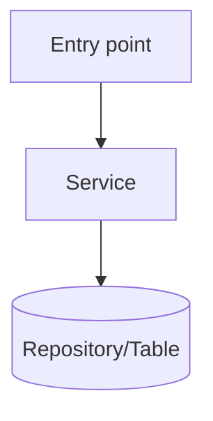

<!--
PURPOSE:     Navigational map from processes to code. Speeds up review and future spikes.
OWNER:       Agent drafts · Tech Lead reviews
CONSUMED BY: extract-code-rules (next runs), cross-reference, write-sdd
-->
# Code Map (SPIKE-###)

- **Repos analyzed:** org/repo@<sha> …

## <P-PROC> <name>
### Entry points
| Type (API / batch / consumer / UI) | Identifier (endpoint, job, topic) | Location |
|---|---|---|

### Call chain

### Key components
| Component | Responsibility | Location | KUs |
|---|---|---|---|

### Config and constants
| Name | Value | Where defined | Runtime-overridable? |
|---|---|---|---|

### Observations
<!-- dead code, duplication, hard-coded values, missing tests -->
