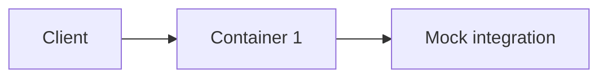

<!--
PURPOSE:     Defines the hypothesis and minimal slice of a PoC before building.
OWNER:       Agent drafts · Architect approves (G6)
CONSUMED BY: build-poc, poc-findings
-->
# POC-###-<slug>: Plan

> **🟨 ASSUMPTION — review & approve.** Agent-drafted. **Approver:** Architect · **Blocks:** build

- **Capability:** CAP-###-<slug> · **SDD version:** · **Timebox:** <days>

## 1. Hypothesis
"We believe <design/approach> can <achieve X> on <platform> within <constraints>."

## 2. Slice
| REQ / AC | In PoC? | Why |
|---|---|---|

## 3. Architecture slice

| Container | Image base | Responsibility | Resources |
|---|---|---|---|

## 4. Integrations
| INT | Real or mock | Contract source |
|---|---|---|

## 5. Data
- Synthetic data set description

## 6. Success criteria
- [ ] Builds per platform-openshift.md · [ ] ACs pass · [ ] <NFR demo>

## 7. Architecture compliance checklist
- [ ] Base image approved · [ ] non-root · [ ] limits set · [ ] config via ConfigMap · [ ] secrets via Secret · [ ] logging format

## 8. Risks
