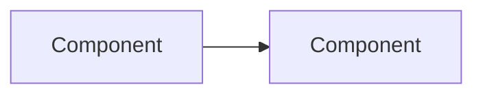
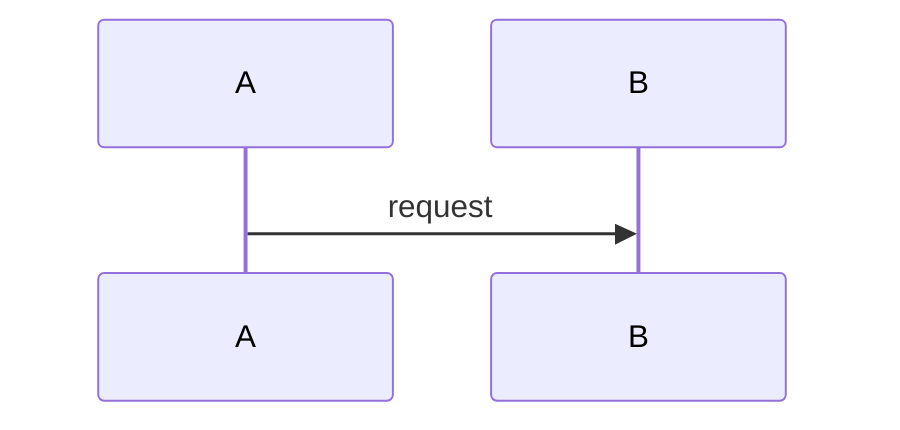

<!--
PURPOSE:     Spec-Driven Development package: requirements → design → tasks. Drives agents, developers, and PoCs.
OWNER:       Agent drafts · Tech Lead / Architect approves (G5b)
CONSUMED BY: plan-poc, build-poc, future construction
-->
# SDD: CAP-###-<slug> <capability name>

> **🟨 ASSUMPTION — review & approve.** Agent-drafted. **Approver:** Tech Lead / Architect · **Blocks:** PoC

- **Version:** 0.1 · **PRD:** ./prd.md · **Architecture refs:** 00-context/architecture/…
- **Design status:** final | provisional (architecture inputs missing: …)

## Part 1: Requirements
### REQ-001 <title>
- **EARS:** When <trigger>, the system shall <response>.
- **Source:** VR-<PROC>-### / PRD goal / decision:…
- **Change:** new | modified | unchanged
- **Acceptance criteria:**
  - [ ] AC-001.1 Given … when … then …
  - [ ] AC-001.2 …

### Non-functional requirements
| NFR | Target | Ref nfrs.md |
|---|---|---|

## Part 2: Design
### Components

| Component | Responsibility | Tech (per standards.md) |
|---|---|---|
### Data model
### APIs / events / files (contracts)
### Key sequences

### Integrations (ref integration-catalog.md)
### Security, observability, error handling
### Design decisions (ADRs)

## Part 3: Tasks
| Task | Description | REQ refs | Est. | PoC slice? |
|---|---|---|---|---|
| T-01 | | REQ-001 | | Y |

## Test strategy
