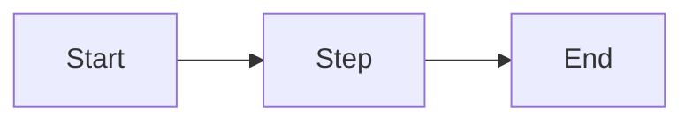

<!--
PURPOSE:     THE validated As-Is for one process. Only ✅ items and human-resolved items.
OWNER:       Agent compiles · Alejandra + Tech Lead sign off
CONSUMED BY: write-prd, write-sdd, future teams
-->
# Validated As-Is: <P-PROC> <process name>

> **🟨 ASSUMPTION — review & approve.** Agent-compiled. **Approver:** Alejandra + Tech Lead · **Blocks:** Phase 5

- **Spike:** SPIKE-### · **Version:** 1.0 · **Date:**
- **Coverage:** As-Is KUs found in code: x% · Code KUs documented: y%

## 1. Overview
## 2. Actors and systems
## 3. Process flow

## 4. Business rules (validated)
| Rule ID | Step | Rule | Basis (✅ match / decision) | Citations |
|---|---|---|---|---|
| VR-<PROC>-001 | | | ✅ KU-ASIS-… = KU-CODE-… | doc:… · code:… |

## 5. Data entities
## 6. Integrations
## 7. Known gaps and open items
| Item | Type (undocumented / orphan / open) | Owner | Ref |
|---|---|---|---|

## 8. Sign-off
| Role | Name | Date |
|---|---|---|
| As-Is owner | | |
| Tech Lead | | |
